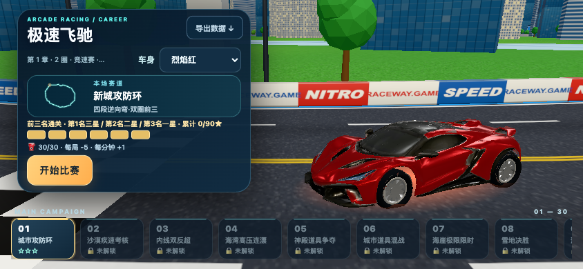
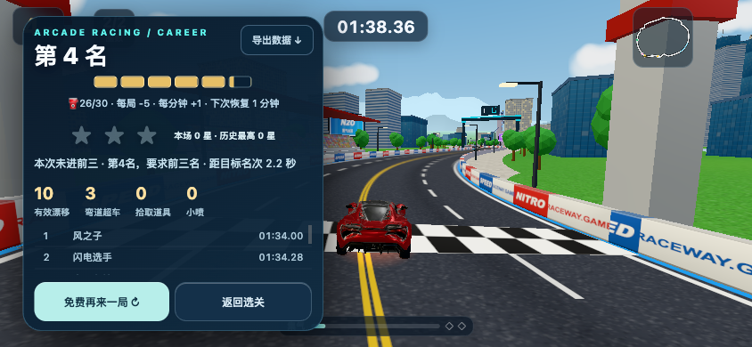
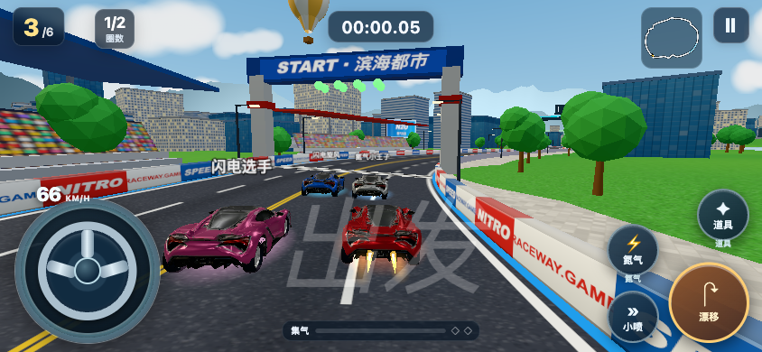

# 极速飞驰：单款混元赛车（PR #60 后续候选）

Target: `runs/h5-qq-mobile-20261013/workspace` only. Baseline PR #60 head:
`6e3e12b5f845b06558d8928d7beca8c4aee3ef80`.

## Generation / authorization

- User authorized changing from unavailable TokenHub API to the official **Hunyuan web** free-quota route. This is not evidence that Tencent API credentials work.
- One Hunyuan 3.1 multiview submission: original front, front-left 45°, left and rear references; 50K mesh setting. Observed quota **20 → 19**. No repeat generation, remesh purchase or conversion purchase.
- Source GLB: 37,366,180 bytes; 49,938 triangles; SHA-256 `8af8f5579f645017ba3d9120210579d2db20008c3f815de856cb44411e2a9171`. Source and run-bound reference evidence remain local, outside Git.
- Hyper3D MCP OAuth was configured and its 7 tools enumerated. Its single basic generation request was rejected with `SUBSCRIPTION_REQUIRED`; no accepted job/debit details were returned. No subscription purchase/retry. Hunyuan web quota is not assumed interchangeable with TokenHub or Rodin credits.
- No secrets, cookies, OAuth tokens or signed download URLs belong in this change.

## Runtime contract

The existing native `buildCar` path uses the same cached GLB for menu, six race cars, settlement and replay. No poster/sprite substitution. Parse once before any native racer creation; share geometry and texture resources, clone materials per car. The binary is embedded in the existing standalone HTML so the one-file preview/offline path does not acquire an external asset/CDN dependency.

Five named chassis materials (`BodyPaint`, `Glass`, `Headlight`, `Taillight`, `Trim`) retain the original PBR atlas. Body paint uses a smooth per-texel pale-paint mask so dark inlets/windows are not multiplied by the eight original paint colors. `Tire` and `Rim` are separate mechanical materials. Wheels use independent car-space steer-Y and spin-X pivots, outside the body lean group. Native flames, glow, shield, names, collision/physics and AI remain owned by the existing engine.

The verified baseline actually had a central modal and stage dropdown, not the requested bottom rail. The candidate keeps one existing home and existing selection/gate semantics, exposes 30 horizontal stage buttons, and frames the actual selected native car beside the controls. No additional lobby or event system.

## Offline reproduction

The checked-in GLB is the build input. Do not install optimization tooling in the production runtime. Optional local reprocessing of the SHA-pinned source:

```sh
mkdir -p runs/h5-qq-mobile-20261013/workspace/asset-tools
cd runs/h5-qq-mobile-20261013/workspace/asset-tools
npm init -y
npm install --ignore-scripts --save-exact @gltf-transform/cli@4.5.1 meshoptimizer@1.2.0 sharp@0.35.5
cd ../../../..
node tools/lean-pilot/racing-car-prepare.mjs \
  --source runs/h5-qq-mobile-20261013/workspace/assets/original-racer/source/hunyuan-v31-source.glb \
  --output /tmp/optimized-racer.glb --manifest /tmp/optimized-racer.manifest.json \
  --tool-root runs/h5-qq-mobile-20261013/workspace/asset-tools
```

Meshoptimizer is used offline for simplification only. No meshopt/Draco runtime decoder or native sharp/libvips binary is shipped. Review the research artifact and exact installed codec notices before redistributing build tooling.

## Acceptance status

**Draft candidate; product gate BLOCKED, not release-approved.** Machine/visual/natural evidence and final metrics are recorded separately in `verification.json`. Browser phone viewport emulation is not a physical iPhone/Android benchmark. WeChat/Douyin/TapTap adapters and package publication remain unverified; `publishable: false` stays intact. Baseline repository-wide Vitest has pre-existing runner-mismatch/E2E failures; do not reinterpret those as a full green suite.

## Primary documentation reviewed

- [Tencent HY-3D TokenHub API](https://cloud.tencent.com/document/product/1823/137181): separate API-key authorization; web login/free quota is not an API key.
- [Tencent Hunyuan 3D web](https://3d.hunyuan.tencent.com/): the user-authorized generation route actually used here.
- [Three.js r169 GLTFLoader](https://github.com/mrdoob/three.js/blob/r169/examples/jsm/loaders/GLTFLoader.js): pinned runtime loader, embedded GLB/PBR material parsing.
- [glTF Transform 4.5.1](https://github.com/donmccurdy/glTF-Transform/tree/v4.5.1): offline simplify/export infrastructure; approved scope and direct licenses are in the Zod-validated research artifact.

The user-authorized web-generated source is retained for internal QA. This change does not assert commercial clearance for all inherited game/source/asset rights, nor advertise a publishable Mini Game package.

## Final local evidence

- Final asset **1,270,084 bytes /17,473 triangles**, three 1024px maps; original37.37MB export is not shipped. The actual car has19 meshes including native effects (baseline 46); textures/geometry are shared across cars.
- Standalone game HTML2,786,629 bytes (1,379,370 bytes gzip). Original eight paints and semantic materials preserved; wheels are honest local mechanical retopology inside the same GLB, not claimed as AI-separated parts.
- Chromium/ANGLE Metal: desktop 1440×900, phone 844×390 and portrait 390×844; default home/race, multi-touch steer/drift,30-stage rail and rotation guide passed.740×360 and seeded multi-track/desktop engineering smoke also passed. This is not physical-phone performance.
- Fresh normal-touch stage 01 actually finished in 98.36 game seconds, fourth place, 0 stars; same model at visible settlement and ordinary free replay. The existing podium natural-journey gate remains **BLOCKED**; no win/state/time was injected. Natural desktop settlement and 30-stage natural campaign are not certified.
- Lint/typecheck, native physics/AI/hash regression and targeted tests pass. Repository-wide Vitest still fails 48 inherited node:test runner-mismatch suites plus the existing unknown-waiver-binding test (49 failed files, 974/975 tests pass); earlier baseline also had a transient cut-stack E2E timeout. No unrelated assertions were weakened.





Additional fresh-phone UI check: seven trusted CDP touch swipes reached scrollLeft 2300px, all 30 main choices plus a separate Daily choice. Tapping disabled Daily kept stage01 selected; no storage/state injection. Exact observation is in `verification.json.railTouch`; local reproducer stays with run QA evidence.
