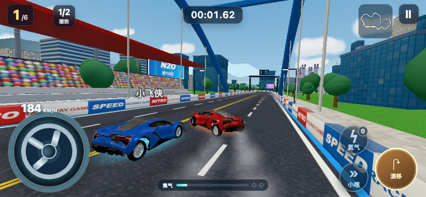
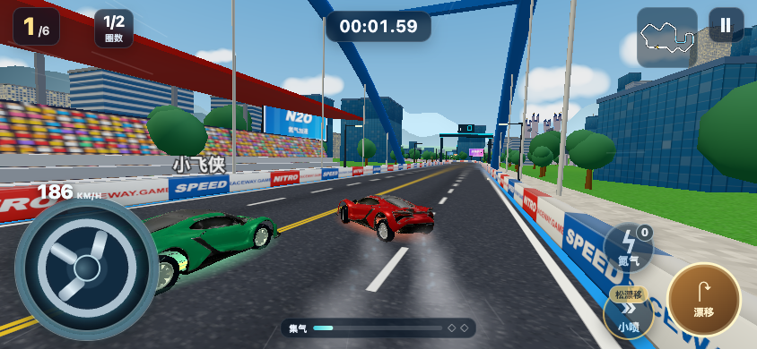
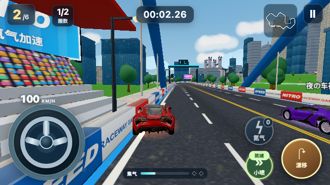

# 极速飞驰 · RC24 出弯小喷反馈候选

**这是可玩的局部体验修复，不是“已证明更好玩”。状态仍为 WEB_RC / BLOCKED，不覆盖 RC23 的历史证据或宣称正式 FIX 已验收。**

目标：`runs/h5-qq-mobile-20261013/workspace`，工作树 `racing-final-acceptance/妖怪夜市`，统一分支 `chatgpt/racing-unified-20261018`，PR #68。正式平台、广告改版、油量经济均不在本次范围。

## 真正改了什么

- **电脑不再吞掉刚出漂前的 W**：复用手机已有的 260ms 单次输入缓冲。只保留玩家真实按下的一次 W；过早输入过期、暂停清空，没有自动小喷，没有免费加速。
- **手机和电脑的小喷控件可预读**：漂移时原控件内蓄条变满、边框转金；干净出漂后转绿，条随真实小喷窗口消退。不是额外赛道横幅。
- **干净出漂的短音**：通过既有 SFX 混音器播放两个轻短音，遵循声音开关。实际喷射仍使用原生尾焰、喷射声音与加速，不重做这些能力。

同类正常键盘操作中，RC23 有 clean driftEnd 却没有 smallBoost；RC24 在 clean driftEnd 后 **8.7ms（游戏时钟记录，不是端到端触控延迟）** 触发一次原生 smallBoost。两场独立比赛不是固定随机种子 A/B，也不能用完赛时间差证明难度改善。

手机原来就有短缓冲，本次没有将它包装成新增能力。667 的一条过早小喷序列仍未喷出，原始失败保留，不能拿 844 的成功替代。补加输入时间戳的小屏复测记录了提前约 242ms 按小喷、出漂后一次喷射；这是单独复测成功，不倒推旧失败的原因。完整小屏比赛另有实际小喷与重开记录。

## 没有改什么

原生车辆物理、AI、赛道几何、道具和六车资源哈希均与 RC23 相同。30 条主线、10 条合法物理近道、前三晋级、存档、手机专属近镜头/电脑原镜头、Space 氮气 / Ctrl 道具、烟雾上限、结算层级和安全广告回调保留。没有 AI 追赶作弊、坐标/名次注入、自动代驾或降低前关压力；五款导入车仍是静态合并车轮。

## 看实际输入，而不是只看测试数

| 当前 RC24 正常输入代理 | 实际结果 | 重开 |
|---|---|---|
| 桌面 1366×768 · 第 01 关 | 第一，112.313s | 已观察 |
| 手机 844×390 · 第 01 关 | 第六，128.997s；失败保留 | 已观察 |
| 小屏 667×375 · 第 01 关 | 第六，124.815s；失败保留 | 已观察 |
| 桌面 1366×768 · 第 06 关 | 第二，117.688s | 已观察 |
| 手机 844×390 · 第 06 关 | 第六，131.671s；失败保留 | 已观察 |

第 06 关使用旧版本通过真实正常输入赢得的原始存档，不注入解锁或成绩。完整结果与手机第 06 关以 `qa-summary.json` 为准。

动作选择只读可见小地图和控件；车辆状态只供断言。录屏、输入追踪、声音采样以及既有失败均在同一 run 的 `artifacts/replay-20261021/` 和交付证据包。两次 QA 采集器错误、并发测试造成的长截图等待均保留，不冒充产品修复或稳定性能证据。

### 手机：原控件内的蓄成状态

| RC23 | RC24 |
|---|---|
|  |  |

## 验证与未解决项

`formal-fixer`，修复历史 23 → 24，仅构建一次；当前执行 chat 和原 stored thread 均记录，没有替换旧计数。实际改动仅专用 racing 模板四个因果相关文件，既有构建器生成目标工作区；没有改共享工厂流程或其他游戏。

改动文件为专用 `racing/driver.mjs`、`racing/presentation.mjs`、`racing/mobile.mjs`、`racing/mobile.css`；新增 `tests/racing-replay-feel.test.mjs`。选择正式路径的原因是涉及核心输入及体验验收；刻意未传递/扩展到其他游戏、广告经济方案、平台凭据、额外 Agent/Gate 和无关仓库历史。

定向测试先红后绿，438 条赛车原生测试无跳过、12 个原生玩家检查、30 关 150 个物理 AI 完赛、10 个物理近道及六车型检查有记录。完整 Chromium smoke、844/667 真实触控生命周期、广告 SDK fixture 和 Mac WebKit 检查通过（不是实际广告或 iPhone）。旧 touch 采集器的截图超时亦保留。作用域 lint/typecheck 通过。全库 lint/test 的旧脚本全局声明、node:test 被 Vitest 收集、过期豁免和无关 cut-stack 用例失败照实保留，未为了本次任务修改其他项目。

Mac 临时目录 `/var` 与真实 cwd `/private/var` 的路径差异曾让交付验证器 fixture 拒绝自身证据；同一测试使用目标 run 内的规范临时目录后通过，验证规则未改。

**独立感知验收仍 BLOCKED**：本 chat 进行了截图自检，但没有另加 Reviewer Agent，也没有将作者自检标成独立通过。真实 Android/iPhone、真人愿意重玩、全 30 关自然完成、正式平台配置、真实广告和权利链仍未全部验证。没有实际提审。

没有足够证据支持继续改物理或 AI；本次保留最小补丁，等待独立手机/真人反馈，再决定保留或回退体验改动。不能从一次代理胜负推导“已经更好玩”。
