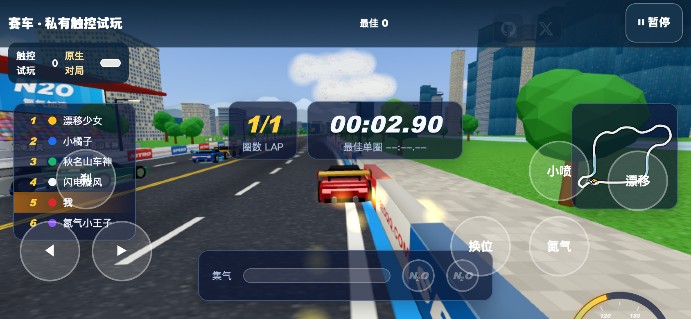
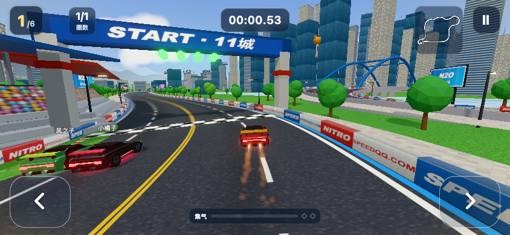
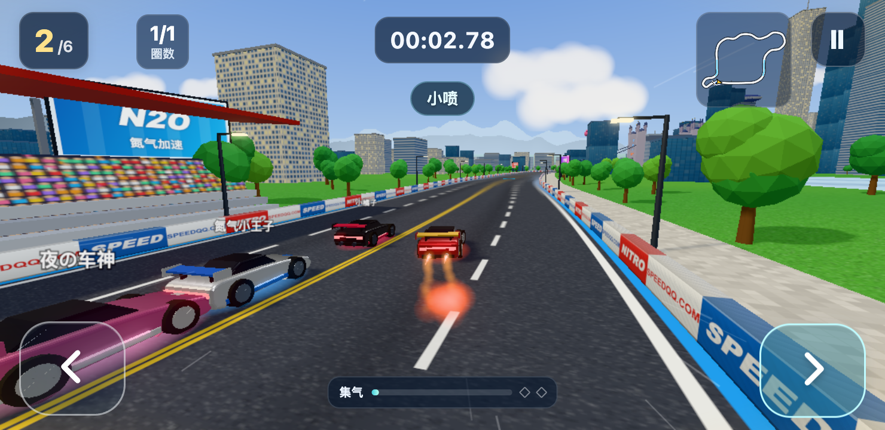
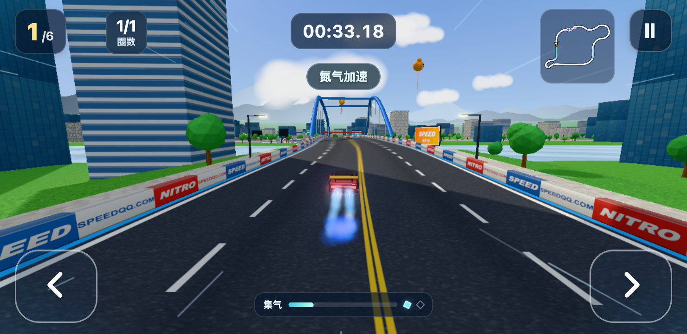

# 双键飞驰 · 手机横屏赛车交付

本次目标是 **3D 赛车 H5 / qq-speed**，运行编号 `h5-qq-mobile-20261013`。基于 PR #10 的 `b3e9e41dbafd9fecff972e0838aec8bed8220afc`，使用独立分支 `codex/race-two-button-20261014`。目标工作区为 `/Users/kker/.codex/worktrees/race-two-button/妖怪夜市/runs/h5-qq-mobile-20261013/workspace`。

同一 Wi-Fi 的手机可打开 **[中文横屏试玩](http://172.16.133.209:4335/?theme=qq-speed)**。此地址依赖当前电脑和预览服务；横屏后点击“开始比赛”，按住左右转弯，松手回正。第一场为新手难度、1 圈、6 人，暂停菜单提供画质设置。原有四张赛道均可选择；结算可“再来一次”或“下一场”。

## 改造结果

- 比赛中保留左右两个驾驶按钮和一个暂停按钮。名次、圈数、计时、小地图与细集气条统一布局，原来的七键、完整排行榜和重复 HUD 已隐藏。
- 手机模式自动油门。漂移由速度、同向转向时长、车身姿态及真实赛道曲率共同判断，再驱动原生 `shift`；左右方向完全来自玩家输入。
- 有效漂移结束后，在原生约 0.5 秒窗口消费一次小喷边沿。完美小喷要求干净的松手出弯与车身恢复，其余合格漂移等待普通窗口。
- 氮气保留原生容量与集气机制，车身稳定且前方曲率较小时自动使用。碰撞、失控、低速、正在漂移等状态会阻止自动奖励或氮气使用。
- 增加短促的中文漂移、小喷、氮气、碰撞和超车反馈。保留原生喷火与声音，减少手机端烟雾、叠加光斑和泛光，赛车与前方道路仍可辨识。
- 默认均衡画质，持续低帧率时自动降一档；暂停菜单手动选择优先。后方跟随镜头限制 FOV，取消手机氮气随机抖动，减轻碰撞晃动。
- 暂停与旋转屏幕清除所有输入。修复了另一只手仍按方向时，第二根手指点暂停无法产生 `click` 的真实多点触控分支。

原生 `vehicle.js` 与 `ai.js` 的 SHA-256 与固定版本完全一致：

| 文件 | SHA-256 |
| --- | --- |
| `vehicle.js` | `667b7aae414b9c19822cef59021f2619fa83be837a00c3fd5ed98edb0e425104` |
| `ai.js` | `2a399dad5831ec9ac8c22b76d837b908ed171f66e7510e5ef80679ef19b78f7e` |

## 正常触屏完整比赛

三局均使用新浏览器上下文，从菜单正常启动，只发送左右触控，真实冲线、结算并重开。测试驾驶策略只读取可见小地图像素，游戏状态只用于事后断言；没有修改车辆位置、赛程或胜利状态。三局对应同一最终构建 `82a53d7f6fd2c99cb749473b4642bc860c3ad444a4f03d502b11da678ced37fa`。

| 浏览器视口 | 完赛时间 | 实际名次 | 漂移 / 小喷 / 完美 | 氮气使用 | 后续操作 |
| --- | --- | --- | --- | --- | --- |
| 844 × 390 | 41.80 秒 | 1/6 | 21 / 16 / 1 | 1 | 再来一次，进入新比赛 |
| 852 × 393 | 42.99 秒 | 1/6 | 22 / 15 / 2 | 1 | 下一场，进入原生海滨山城 |
| 740 × 360 | 41.12 秒 | 1/6 | 23 / 16 / 4 | 1 | 再来一次，进入新比赛 |

`luna_worker` 输入审计独立核对了 47 次小喷：每次均对应一个不同的合格漂移结束，没有孤立奖励或重复消费；40 次普通、7 次完美。每局氮气均满足“初始 0 + 集得 3 = 使用 1 + 剩余 2”。另一位 `luna_worker` 独立运行布局、多点触控、暂停和旋转检查，并复核完整比赛的原始轨迹及特效截图。完整比赛由主线程的 Playwright 脚本驾驶；报告没有把轨迹复核写成 QA 子代理亲自驾驶。

所有自然报告保留 `coreJourneyPassed=true`、`gates.realBackground=BLOCKED`、整体 `passed=false`。核心比赛通过与整体验收阻塞是分别记录的。

## 截图

以下是本次绑定到目标运行的浏览器截图。旧版截图来自 PR #10 基线，未使用本次未提供的旧 iPhone 截图。

| PR #10，844 × 390 | 双键版，844 × 390 |
| --- | --- |
|  |  |

| 小喷，740 × 360 | 氮气，740 × 360 |
| --- | --- |
|  |  |

## 验证与限制

| 验证 | 结果与范围 |
| --- | --- |
| ESLint / TypeScript | 最终直接运行均通过 |
| 本适配层与构建测试 | Node test 39/39 通过 |
| 原生物理专项 | 3/3 通过，含真实 `Track` / `PlayerCar` 与 144Hz 输入对 120Hz 物理的单次边沿消费；属于 fixture 工程证据 |
| 手机 UI 冒烟 | WebKit 5/5 通过，含按钮、计时宽度、对比度和中央驾驶区域 |
| 触屏操作专项 | 主线程 Chromium 33/33；独立 QA Chromium 55/55，另有三个 WebKit 视口布局通过 |
| 完整核心路径 | 三种横屏尺寸的启动 → 比赛 → 冲线结算 → 重开或下一场通过 |
| 四张原生赛道 | 每张正常选择、加载并开始，均有 6 辆车与原生玩家；完整比赛只验证城市巡回 |
| 真实切后台 | **BLOCKED**：真实切页、失焦和最小化尝试均未让本机自动化页面收到 `blur` / `hidden`，未用合成事件替代 |
| 实体手机 | 刘海安全区、双拇指手感、设备帧率及扬声器声音待真人验收 |
| 工厂全量 Vitest | 167 文件 / 964 测试通过，24 文件 / 11 测试失败；原始日志保留。包括 Vitest 错误收集 Node test 文件、`pnpm` 非交互依赖检查及过期 waiver fixture。未修改无关工厂测试 |

电脑 Apple M1 Pro / Metal 的帧时间样本约为中位 8.3ms、P95 9.2ms，**不能作为手机帧率证明**。CSS `env(safe-area-inset-*)` 和三个常见横屏比例已验证，实体刘海区域仍需真实 Safari/Android 浏览器确认。

请在手机上完成少量补充验收：

1. 按住方向时切到其他 App，再回来；应停在暂停页。点“继续比赛”后应无卡键、无重复小喷或起步奖励。
2. 横屏双拇指试玩一局，检查按钮触达、刘海边缘、前方弯道与赛车可见；旋转为竖屏应暂停，转回后手动继续。
3. 连续玩 30–60 秒，听漂移与喷射声音、观察帧率和发热；必要时在暂停菜单切为“流畅”。

目前是可试玩的 **H5 Draft 候选**，正式 QA 与感知门禁保留阻塞。没有把浏览器证据作为微信、抖音或 TapTap 小游戏包的发布证明。

## 代码与重现

运行入口由原生 Three.js `workspace/source/qq-speed/src/main.js` 和 `templates/web-lite/h5-source-mobile-v1/racing/{mobile.mjs,driver.mjs,session.mjs,mobile.css}` 组成。旧 `workspace/game/main.mjs`、`engine.mjs`、`themes.mjs` 是兼容留存文件，新默认 HTML 没有引用它们。

仅新增 qq-speed 专用输入/UI/渲染适配、构建扩展、定向 QA、测试及本文证据。没有修改其他游戏或共享工厂运行逻辑。源码和生成构建沿用原有忽略规则，授权原版来源为 `riba2534/claude-opus-5-5-demo` 的 `54adc1fb64155f9dd7c1c90ecae7b8185ac540b8`；原作者授权依据为用户既有确认，详见 `open-source-research.json`，不把它描述为已核实的开源许可证。

在仓库根目录，准备该固定版本的已授权源码目录后执行：

```sh
H5_PINNED_SOURCE_ROOT='/absolute/path/to/authorized/upstream' node tools/lean-pilot/racing-mobile-build.mjs
node tools/lean-pilot/runner.mjs serve h5-qq-mobile-20261013 4335 <本机局域网地址>

node node_modules/eslint/bin/eslint.js .
node node_modules/typescript/bin/tsc --noEmit
node --test templates/web-lite/h5-source-mobile-v1/tests/*.test.mjs tools/lean-pilot/tests/racing-build.test.mjs
RACE_NATIVE_PROJECT='/absolute/path/to/runs/h5-qq-mobile-20261013/workspace/source/qq-speed' node --test tools/lean-pilot/tests/racing-native-physics.test.mjs

node --import tsx docs/race-two-button-20261014/verify-evidence.mjs
```

专项 Playwright 脚本为 `racing-smoke-qa.mjs`、`racing-controls-qa.mjs`、`racing-touch-qa.mjs`；调用方式与环境变量见各文件开头。正常比赛脚本输出完整原始触控轨迹、事件、截图和录屏。证据归档中的 `.gz` 是原始 JSON 或测试日志的无损压缩，解压后的 SHA-256 与来源及独立 QA 引用一致。

本次走 **formal-fixer**，因为改造涉及核心输入、比赛状态、多个模块与默认运行入口。保留既有修复次数 2，七次有变化的构建递增至 9，每次保留 QA 失败与新假设；最终相同输入重复构建返回 `reused:true`，未增加次数。上下文只含目标赛车、用户任务、固定源码和定向 QA，省略其他两款游戏与无关工厂历史。`repair-history.json`、`qa-final.json`、`runtime-product-gate.json` 和独立报告记录当前证据与缺口；本交付没有宣称已完成正式 FIX 或发布验收。
